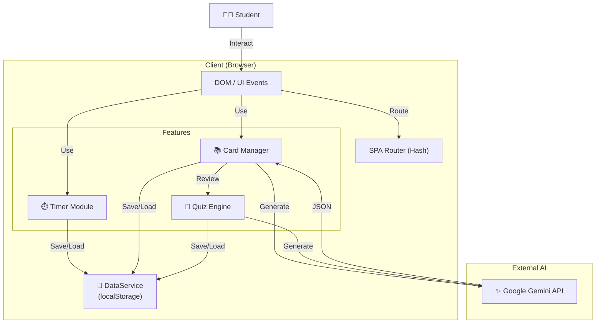

# Study Hub - Integrated Learning Environment 📚

<p align="center">
  <b>「集中、記憶、そして遊び心の統合」</b><br>
  All-in-One Learning Tool built with Vanilla JS & Vite
</p>


---

## 🌐 Demo

**[https://study-hub-vert.vercel.app/](https://study-hub-vert.vercel.app/)**

## 📖 概要 (Overview)

**Study Hub** は、学習に必要な3つの要素「時間管理（ポモドーロ）」「記憶定着（単語帳）」「理解度確認（AIクイズ）」をひとつのWebアプリに統合したツールです。
フレームワークを使わず **Vanilla JS** で構築されており、超軽量かつ高速に動作。ゲーミフィケーション要素（バッジ、XP）により、孤独になりがちな自習を楽しくサポートします。

## ✨ 主な機能 (Key Features)

### 1. ⏱️ Focus Timer (集中タイマー)
* **カスタマイズ:** 25分集中/5分休憩など、自分のリズムに合わせて設定可能。
* **連動:** タイマー完了時にXPを獲得し、レベルアップに寄与します。

### 2. 🧠 Smart Flashcards (暗記カード)
* **技術:** 「スペースドリピティション（間隔反復）」の概念を取り入れ、苦手なカードを重点的に復習可能。
* **AI生成:** トピックを入力するだけで、Gemini AIが自動で単語帳を作成します。

### 3. 🤖 AI Quiz Generator (無限クイズ)
* **概要:** 作成した単語帳や、任意のトピックから4択クイズを即座に生成。
* **解説:** 正解/不正解だけでなく、AIによる詳しい解説が表示されます。

---

## 🛠 技術スタック (Tech Stack)

| Category | Technology | Usage |
| :--- | :--- | :--- |
| **Frontend** | **Vanilla JavaScript (ES6+)** | No Framework, High Performance |
| **Bundler** | **Vite** | Fast HMR & Build |
| **Styling** | **CSS3** | Custom Variables, Flexbox/Grid |
| **AI Model** | **Google Gemini 1.5** | Quiz & Flashcard Content Generation |
| **Storage** | **localStorage** | Client-side Persistence |

---

## 🏗️ アーキテクチャ (Architecture)



---

## 🚀 セットアップ (Getting Started)

### Prerequisites
* Node.js 18+
* Google Gemini API Key

### Installation

1. Clone the repository:
   ```bash
   git clone https://github.com/naki0227/study-hub.git
   cd study-hub
   ```

2. Install dependencies:
   ```bash
   npm install
   ```

3. Set up environment variables:
   Create `.env`:
   ```env
   VITE_GEMINI_API_KEY=your_api_key_here
   ```

4. Run:
   ```bash
   npm run dev
   ```

---

## 👨‍💻 開発者 (Developer)
**Enludus**

Focus: Lightweight Web Apps & AI Integration
Contact: <https://enludus.com>

<p align="center"> 
    © 2025 Study Hub Project. All rights reserved. 
</p>
